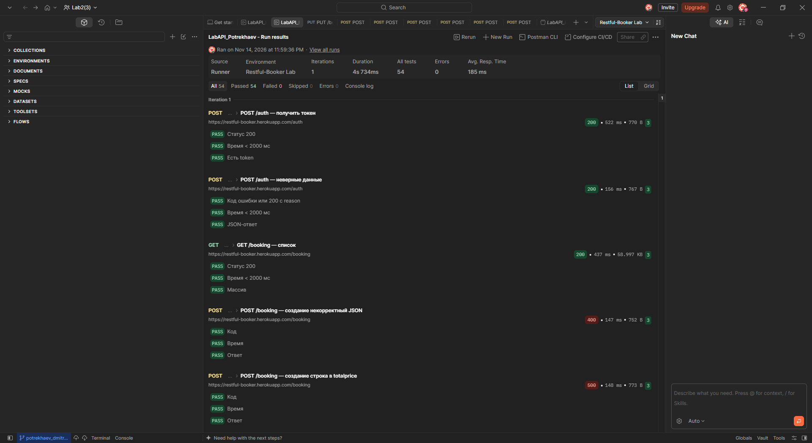
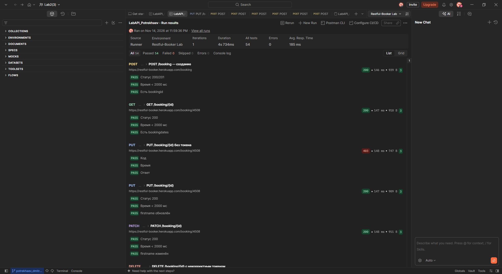
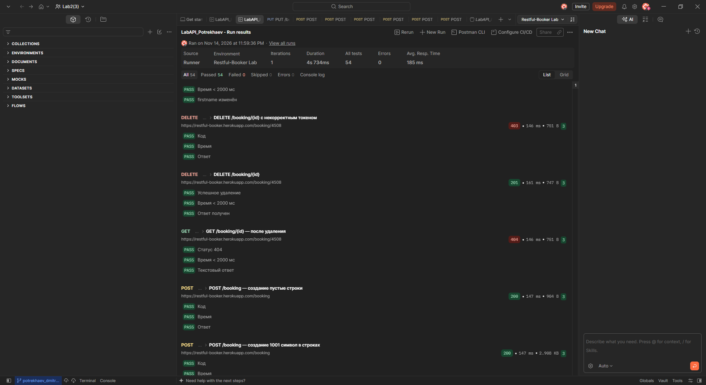
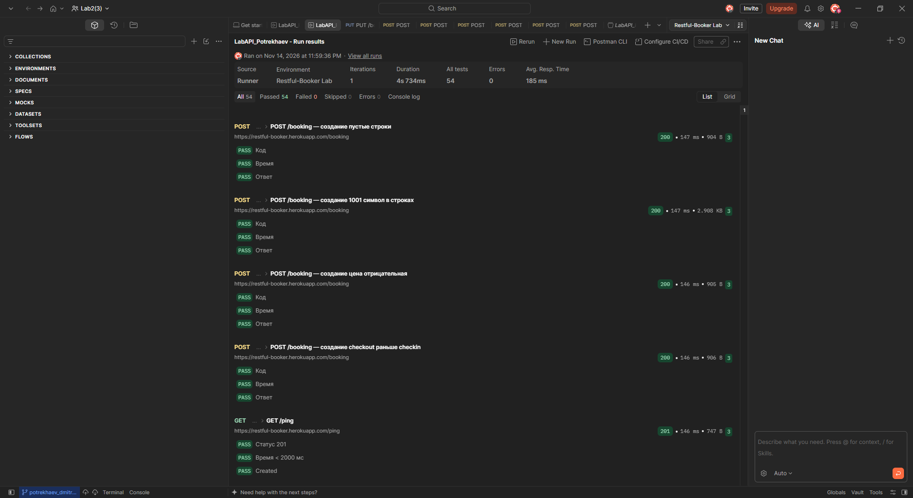

# Лабораторная работа № 2(3). Интеграционное и API-тестирование

## Выполнил студент группы ВТ-231 Потрехаев Дмитрий

## Цель работы

Освоить тестирование REST API на примере открытого публичного сервиса: научиться строить в Postman коллекцию запросов, писать автоматические проверки и анализировать расхождения между документацией и фактическим поведением API.

## 1. Описание сервиса и тестируемых эндпоинтов

Restful-Booker — учебный REST API для бронирования номеров отеля. Токен авторизации передаётся в заголовке `Cookie: token=<значение>`. Все эндпоинты:

| Метод | Эндпоинт | Назначение |
|---|---|---|
| POST | `/auth` | получение токена (admin / password123) |
| GET | `/booking` | список идентификаторов бронирований (с фильтрами) |
| GET | `/booking/{id}` | получение бронирования |
| POST | `/booking` | создание бронирования |
| PUT | `/booking/{id}` | полное обновление (нужна авторизация) |
| PATCH | `/booking/{id}` | частичное обновление (нужна авторизация) |
| DELETE | `/booking/{id}` | удаление (нужна авторизация) |
| GET | `/ping` | проверка работоспособности |

Структура коллекции `LabAPI_Potrekhaev`: папки **Auth**, **Booking**, **Health**; переменные окружения `baseUrl`, `token`, `bookingId`.

Цепочка сценариев работает без ручного вмешательства: токен из `POST /auth` сохраняется скриптом в переменную `token`, идентификатор созданного бронирования — в `bookingId`; оба используются последующими запросами через `{{token}}` и `{{bookingId}}`.

## 2. Таблица тест-кейсов

Фактические результаты соответствуют прогону из раздела «Скриншоты».

| ID | Эндпоинт | Тип | Входные данные | Ожидаемый результат | Фактический результат | Статус |
|---|---|---|---|---|---|---|
| TC-01 | POST /auth | Позитивный | admin / password123 | 200, поле `token` | 200, токен получен и сохранён в переменную | Passed |
| TC-02 | POST /auth | Негативный | неверный пароль | 401/400 | **200** с телом `{"reason":"Bad credentials"}` | Passed (с замечанием) |
| TC-03 | GET /booking | Позитивный | без параметров | 200, массив `{bookingid}` | 200, массив (58 997 КБ ответа) | Passed |
| TC-04 | POST /booking | Позитивный | корректное тело (Ivan Petrov, 150, 2026-12-01…2026-12-10) | 200/201, `bookingid` | 200, `bookingid = 4508`, сохранён в переменную | Passed |
| TC-05 | GET /booking/{id} | Позитивный | `{{bookingId}}` | 200, данные бронирования | 200, есть `bookingdates` | Passed |
| TC-06 | PUT /booking/{id} без токена | Негативный | тело без заголовка Cookie | 401 Unauthorized | **403 Forbidden** | Passed (с замечанием) |
| TC-07 | PUT /booking/{id} | Позитивный | новое тело + `Cookie: token={{token}}` | 200, данные заменены | 200, `firstname = Pyotr` | Passed |
| TC-08 | PATCH /booking/{id} | Позитивный | `{"firstname":"Sidor"}` + токен | 200, изменено только одно поле | 200, `firstname = Sidor` | Passed |
| TC-09 | DELETE с некорректным токеном | Негативный | `Cookie: token=invalid_token_123` | 401/403 | **403 Forbidden** | Passed (с замечанием) |
| TC-10 | DELETE /booking/{id} | Позитивный | валидный токен | 200 OK или 204 No Content | **201 Created** | Passed (с замечанием) |
| TC-11 | GET /booking/{id} после удаления | Позитивный | удалённый `{{bookingId}}` | 404 | 404, текст `Not Found` | Passed |
| TC-12 | POST /booking | Негативный | обрезанный (некорректный) JSON | 400 Bad Request | 400 `Bad Request` | Passed |
| TC-13 | POST /booking | Негативный | `totalprice: "not_a_number"` | 400 | **500 Internal Server Error** | Passed (с замечанием) |
| TC-14 | POST /booking | Граничный | `firstname=""`, `lastname=""` | 400 (валидация) | **200**, пустые строки приняты | Passed (с замечанием) |
| TC-15 | POST /booking | Граничный | строки по 1001 символу | 400 или ограничение длины | **200**, принято | Passed (с замечанием) |
| TC-16 | POST /booking | Граничный | `totalprice = -100` | 400 (бизнес-валидация) | **200**, принято | Passed (с замечанием) |
| TC-17 | POST /booking | Граничный | `checkout` раньше `checkin` | 400 (бизнес-валидация) | **200**, принято | Passed (с замечанием) |
| TC-18 | GET /ping | Позитивный | без параметров | 200 OK | **201 Created** | Passed (с замечанием) |

Каждый запрос содержит минимум три автоматические проверки во вкладке Tests, например для создания бронирования:

```javascript
pm.test("Статус 200/201", () => pm.expect([200, 201]).to.include(pm.response.code));
pm.test("Время < 2000 мс", () => pm.expect(pm.response.responseTime).to.be.below(2000));
const body = pm.response.json();
pm.test("Есть bookingid", () => pm.expect(body).to.have.property("bookingid"));
pm.environment.set("bookingId", body.bookingid);
```

## 3. Таблица расхождений с документацией и «правильным» REST

| № | Запрос | Ожидалось (по REST/документации) | Получено | Вывод (дефект / особенность) |
|---|---|---|---|---|
| 1 | POST /auth (неверные креды) | 401 Unauthorized | 200 с `{"reason":"Bad credentials"}` | Нестандартное поведение; сессия аутентификации не различает успех и отказ. Документированная особенность сервиса |
| 2 | PUT / PATCH / DELETE без токена | 401 Unauthorized | 403 Forbidden | Семантическое отклонение: 403 означает «доступ запрещён», а не «нет аутентификации». Документированная особенность |
| 3 | POST /booking, `totalprice` строкой | 400 Bad Request | 500 Internal Server Error | **Дефект**: ошибка валидации не обрабатывается, сервер отдаёт внутреннюю ошибку |
| 4 | POST /booking, `totalprice = -100` | 400 (бизнес-валидация цены) | 200, бронирование создано | **Дефект**: отсутствует валидация отрицательной цены |
| 5 | POST /booking, `totalprice = 0` | 400 (недопустимая цена) | 200 (по документации 0 — допустимо, но бизнес-логика сомнительна) | Особенность/спорный дефект: нулевая цена пропускается без предупреждения |
| 6 | POST /booking, пустые строки | 400 (обязательные поля не могут быть пустыми) | 200, бронирование создано | **Дефект**: нет валидации пустых значений |
| 7 | POST /booking, строки 1001+ символов | 400 или ограничение длины | 200, принято | **Дефект**: нет ограничения длины строковых полей |
| 8 | POST /booking, `checkout` раньше `checkin` | 400 (бизнес-валидация дат) | 200, принято | **Дефект**: отсутствует логическая валидация периода бронирования |
| 9 | DELETE /booking/{id} (успех) | 200 OK или 204 No Content | 201 Created | Нестандартный код: «Created» после удаления ресурса противоречит семантике REST |
| 10 | GET /ping | 200 OK | 201 Created | Нестандартный код для health-check; проверку пришлось писать под 201 |

## 4. Баг-репорты

### BUG-01. Отсутствие валидации типа поля `totalprice`

- **Серьёзность:** Major.
- **Шаги воспроизведения:** отправить `POST /booking` с телом, где `totalprice` — строка: `{"firstname":"Ivan","lastname":"Petrov","totalprice":"not_a_number","depositpaid":true,"bookingdates":{"checkin":"2026-12-01","checkout":"2026-12-10"}}`.
- **Ожидаемый результат:** 400 Bad Request с описанием ошибки валидации.
- **Фактический результат:** 500 Internal Server Error — необработанное исключение на стороне сервера.

### BUG-02. Принимается отрицательная цена бронирования

- **Серьёзность:** Major.
- **Шаги:** отправить `POST /booking` с `totalprice = -100` и остальными корректными полями.
- **Ожидаемый результат:** 400, цена не может быть отрицательной.
- **Фактический результат:** 200, бронирование создано с отрицательной ценой.

### BUG-03. Принимаются пустые строки в обязательных полях и строки 1000+ символов

- **Серьёзность:** Major.
- **Шаги:** отправить `POST /booking` с `firstname = ""` и `lastname = ""`; затем повторить с именем из 1001 символа.
- **Ожидаемый результат:** 400 — обязательные поля не могут быть пустыми; ограничение длины при его наличии.
- **Фактический результат:** 200 — оба запроса приняты, бронирования созданы.

### BUG-04. Не проверяется логическая согласованность дат

- **Серьёзность:** Major.
- **Шаги:** отправить `POST /booking` с `checkin = 2026-12-10`, `checkout = 2026-12-01`.
- **Ожидаемый результат:** 400 — дата выезда не может быть раньше даты заезда.
- **Фактический результат:** 200, бронирование с отрицательным периодом создано.

### BUG-05. Нестандартные коды ответов (403 вместо 401; 201 для DELETE и /ping; 200 для неуспешной аутентификации)

- **Серьёзность:** Minor (особенность сервиса, но расходится с REST-семантикой и затрудняет интеграцию).
- **Шаги:** выполнить неавторизованные PUT/DELETE, успешную аутентификацию с неверным паролем, DELETE существующего бронирования, GET /ping.
- **Ожидаемый результат:** 401 / 401 / 200 или 204 / 200.
- **Фактический результат:** 403 / 200 с `reason` / 201 / 201.

## 5. Скриншоты прогона коллекции в Collection Runner

Результаты прогона от 14.11.2026, 23:59: Source — Runner, окружение Restful-Booker Lab, 1 итерация, 4 с 734 мс, **All tests 54, Passed 54, Failed 0, Errors 0**, среднее время ответа 185 мс.

_Скриншоты прогона:_




.


## 6. Выводы

Коллекция из 18 запросов покрывает позитивные, негативные и граничные сценарии всех эндпоинтов сервиса; все 54 автоматические проверки прошли без ручного вмешательства — токен и идентификатор бронирования передаются между запросами через переменные окружения, что подтверждает работоспособность цепочки сценариев.

Основные найденные проблемы — слабая серверная валидация входных данных: некорректный тип `totalprice` приводит к 500 вместо 400, а отрицательная цена, пустые строки, сверхдлинные значения и несогласованные даты принимаются без ошибок. Отдельная группа расхождений — нестандартные коды ответов (200 при неверных кредах, 403 вместо 401, 201 для DELETE и /ping), что отражено в таблице расхождений и учтено в проверках. В целом API функционально стабильно и быстро (среднее время ответа 185 мс), но требует доработки валидации на стороне сервера.
