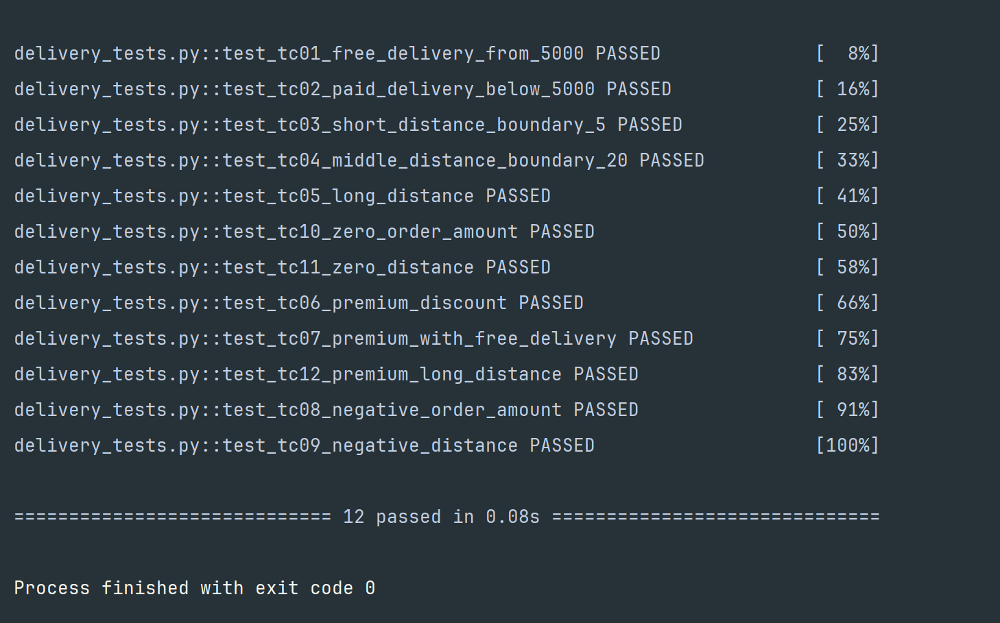

Вывод: Тестирование связывает требования с фактическим поведением программы. В этой лабораторной работе тесты показали, что функция корректно обрабатывает все тарифы, граничные значения, суточный максимум, скидку резидента, бесплатную парковку и ошибки входных данных.

В жизненном цикле ПО такие автотесты важны потому, что они помогают быстро находить регрессии после изменений кода, подтверждают выполнение бизнес-правил и повышают доверие к качеству программы. Запуск тестов в CI делает эту проверку автоматической: ошибка обнаруживается сразу после push, а не при ручной проверке. При этом тесты не заменяют требования и проектирование: если важное поведение не описано в задании, его нужно отдельно уточнять и только потом покрывать проверками