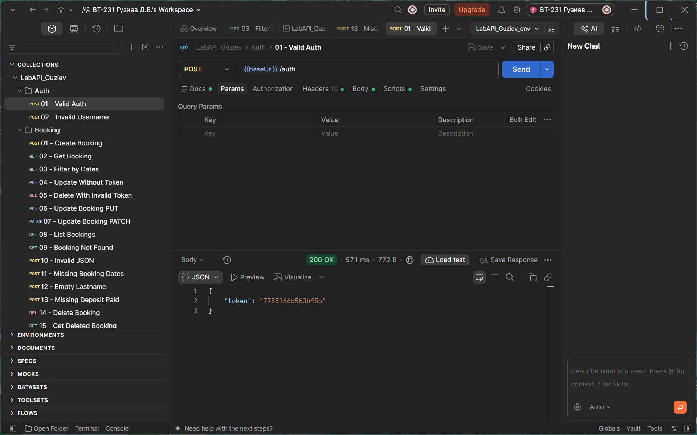
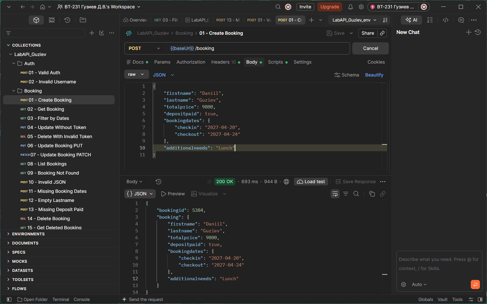
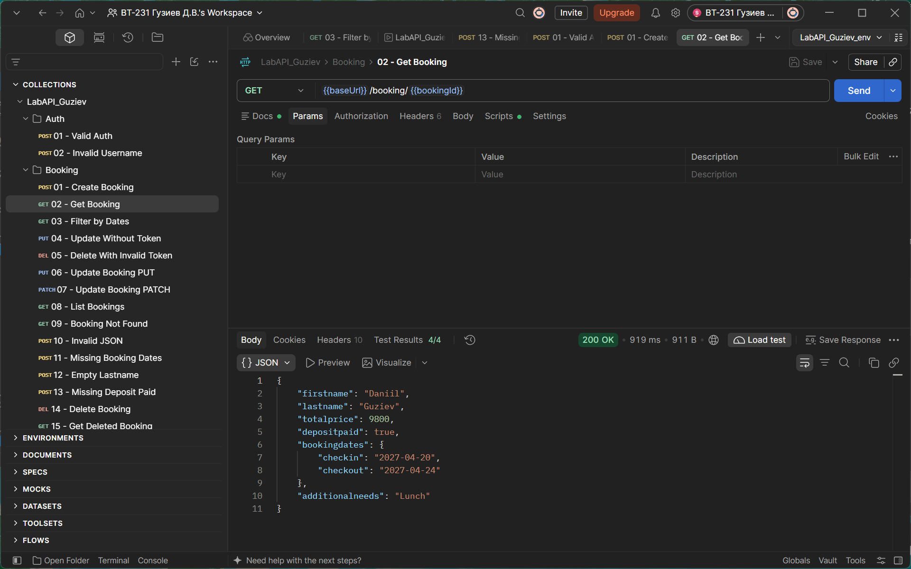
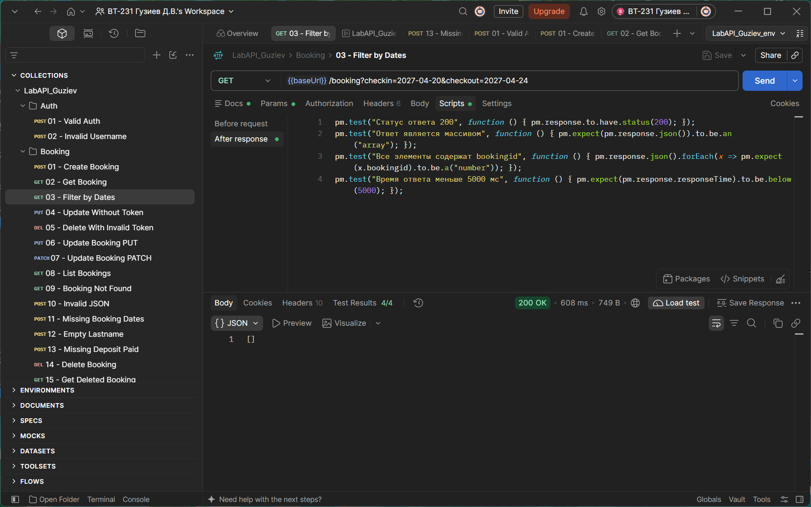
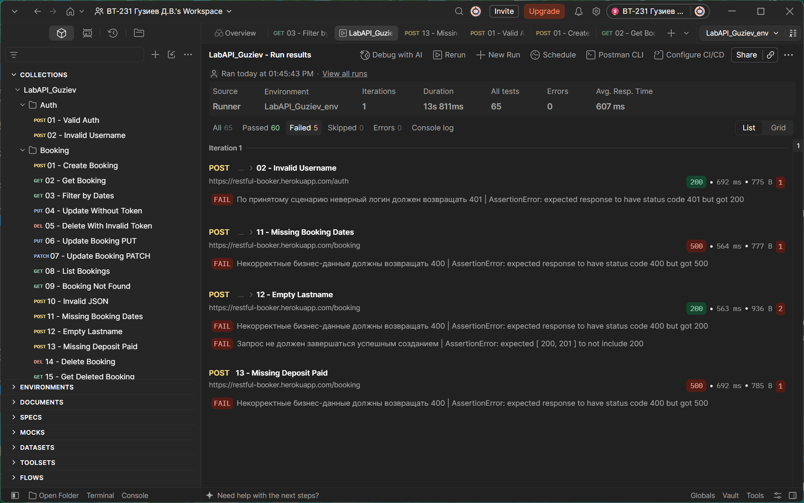
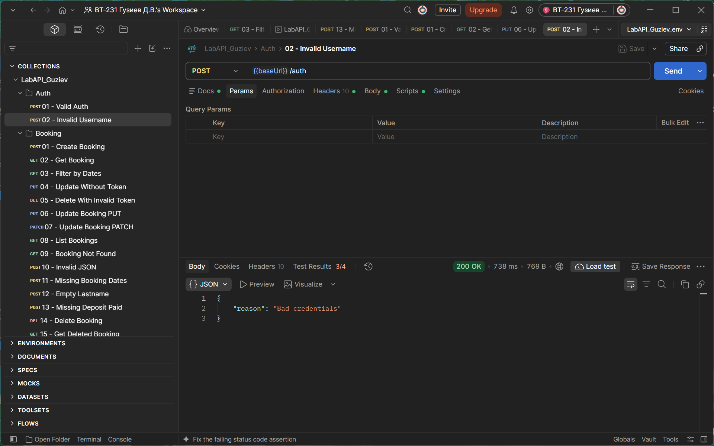
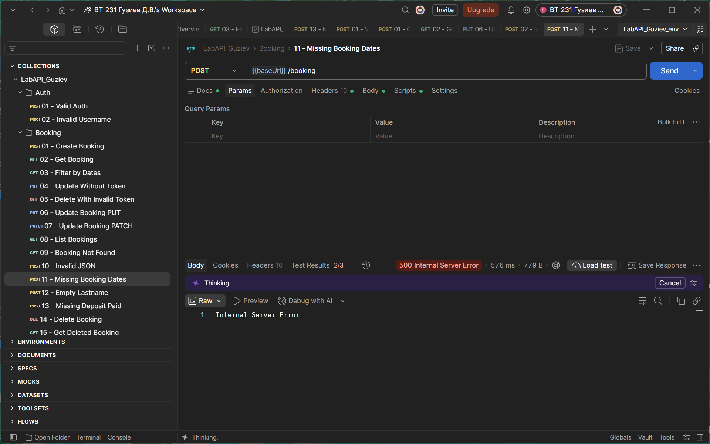
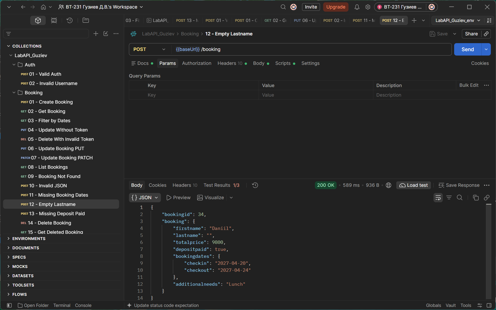
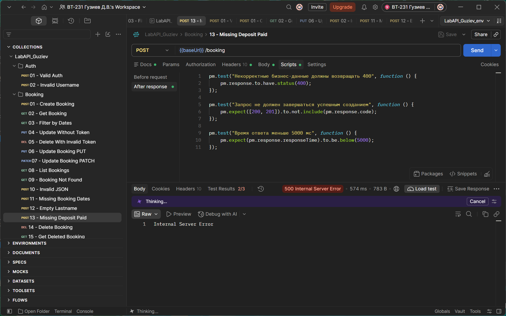

# Лабораторная работа №2
## Интеграционное и API-тестирование

**Выполнил:** Гузиев Даниил  
**Учебная группа:** ВТ-231

---

## Цель работы

Освоить интеграционное и функциональное тестирование REST API в Postman: сформировать набор запросов к публичному сервису, автоматизировать проверки ответов, использовать переменные окружения и проанализировать позитивные, негативные и граничные сценарии.

**Тестируемый сервис:** Restful-Booker  
**Базовый адрес:** `https://restful-booker.herokuapp.com`

Restful-Booker используется как учебный CRUD API для практики тестирования. В работе проверяются авторизация, доступность сервиса и операции с бронированиями.

## 1. Проверяемые эндпоинты

| HTTP-метод | Эндпоинт | Назначение |
|---|---|---|
| POST | `/auth` | Получение токена авторизации |
| GET | `/ping` | Проверка доступности сервиса |
| GET | `/booking` | Получение и фильтрация списка бронирований |
| GET | `/booking/{id}` | Получение бронирования по ID |
| POST | `/booking` | Создание бронирования |
| PUT | `/booking/{id}` | Полное обновление записи |
| PATCH | `/booking/{id}` | Частичное обновление записи |
| DELETE | `/booking/{id}` | Удаление записи |

## 2. Подготовка окружения Postman

Создана коллекция `LabAPI_Guziev`, включающая **18 запросов**. Запросы распределены по папкам:

- `Auth` — авторизация и негативный сценарий с неверным логином;
- `Booking` — CRUD-операции, фильтрация, проверки авторизации и валидации;
- `Health` — проверка `/ping`.

Используется окружение `LabAPI_Guziev_env`.

### 2.1. Переменные окружения

| Переменная | Назначение |
|---|---|
| `baseUrl` | Базовый адрес API |
| `token` | Токен, полученный после успешной авторизации |
| `bookingId` | ID бронирования, созданного в начале сценария |

После успешного `POST /auth` токен автоматически сохраняется:

```javascript
const data = pm.response.json();
if (data.token) pm.environment.set("token", data.token);
```

После создания бронирования сохраняется его идентификатор:

```javascript
const data = pm.response.json();
if (typeof data.bookingid === "number") {
    pm.environment.set("bookingId", data.bookingid);
}
```

Для защищённых запросов используется заголовок:

```text
Cookie: token={{token}}
```

## 3. Состав коллекции

| № | Запрос | Метод | Назначение |
|---:|---|---|---|
| 1 | Valid Auth | POST | Корректная авторизация |
| 2 | Invalid Username | POST | Неверное имя пользователя |
| 3 | Create Booking | POST | Создание бронирования |
| 4 | Get Booking | GET | Получение созданной записи |
| 5 | Filter by Dates | GET | Фильтрация списка по датам |
| 6 | Update Without Token | PUT | Изменение без авторизации |
| 7 | Delete With Invalid Token | DELETE | Удаление с неверным токеном |
| 8 | Update Booking PUT | PUT | Полное обновление |
| 9 | Update Booking PATCH | PATCH | Частичное обновление |
| 10 | List Bookings | GET | Получение списка |
| 11 | Booking Not Found | GET | Несуществующий ID |
| 12 | Invalid JSON | POST | Синтаксически неверный JSON |
| 13 | Missing Booking Dates | POST | Отсутствует объект дат |
| 14 | Empty Lastname | POST | Пустая фамилия |
| 15 | Missing Deposit Paid | POST | Отсутствует поле `depositpaid` |
| 16 | Delete Booking | DELETE | Корректное удаление |
| 17 | Get Deleted Booking | GET | Проверка удаления |
| 18 | Health Check | GET | Проверка доступности API |

Всего подготовлено **65 автоматических проверок**.

## 4. Позитивные тест-кейсы

| ID | Сценарий | Ожидаемый результат |
|---|---|---|
| TC-P01 | Корректная авторизация | HTTP 200, получен непустой токен |
| TC-P02 | Создание бронирования | HTTP 200, возвращён числовой `bookingId` |
| TC-P03 | Получение созданной записи | HTTP 200, данные совпадают |
| TC-P04 | Фильтрация по датам | HTTP 200, ответ является массивом объектов с `bookingid` |
| TC-P05 | Полное обновление PUT | HTTP 200, данные успешно изменены |
| TC-P06 | Частичное обновление PATCH | HTTP 200, изменены выбранные поля |
| TC-P07 | Получение списка | HTTP 200, ответ является массивом |
| TC-P08 | Удаление | HTTP 201 |
| TC-P09 | Получение после удаления | HTTP 404 |
| TC-P10 | Проверка `/ping` | HTTP 201 |

### 4.1. Успешная авторизация

При корректных учётных данных сервис вернул HTTP 200 и токен авторизации.



### 4.2. Создание бронирования

При корректном запросе сервис создал бронирование и вернул числовой `bookingid`.



### 4.3. Получение бронирования

Созданная запись была успешно получена по идентификатору. Все четыре автоматические проверки завершились успешно.



### 4.4. Фильтрация по датам

Запрос фильтрации завершился со статусом HTTP 200. Ответ имеет формат массива, что подтверждено автоматическими проверками.



## 5. Негативные и граничные тест-кейсы

| ID | Сценарий | Ожидаемый результат | Фактический результат |
|---|---|---|---|
| TC-N01 | Неверный логин | HTTP 401, токен отсутствует | HTTP 200, `"Bad credentials"` |
| TC-N02 | PUT без токена | HTTP 403 Forbidden | Проверка пройдена |
| TC-N03 | DELETE с неверным токеном | HTTP 403 Forbidden | Проверка пройдена |
| TC-N04 | Несуществующий booking ID | HTTP 404 Not Found | Проверка пройдена |
| TC-N05 | Некорректный JSON | Ошибка обработки запроса | Проверка пройдена |
| TC-N06 | Отсутствует `bookingdates` | HTTP 400 Bad Request | HTTP 500 |
| TC-B01 | Пустой `lastname` | HTTP 400 Bad Request | HTTP 200, бронирование создаётся |
| TC-N07 | Отсутствует `depositpaid` | HTTP 400 Bad Request | HTTP 500 |

## 6. Используемые автоматические проверки

Проверка HTTP-статуса:

```javascript
pm.response.to.have.status(200);
```

Проверка типа идентификатора:

```javascript
pm.expect(data.bookingid).to.be.a("number");
```

Проверка времени ответа:

```javascript
pm.expect(pm.response.responseTime).to.be.below(5000);
```

Проверка массива:

```javascript
pm.expect(pm.response.json()).to.be.an("array");
```

Проверка элементов массива:

```javascript
pm.response.json().forEach(x =>
    pm.expect(x.bookingid).to.be.a("number")
);
```

Проверка отсутствия успешного статуса в негативном сценарии:

```javascript
pm.expect([200, 201]).to.not.include(pm.response.code);
```

## 7. Порядок выполнения

1. Импортировать `LabAPI_Guziev.postman_collection.json` в Postman.
2. Импортировать `LabAPI_Guziev_env.postman_environment.json`.
3. Выбрать окружение `LabAPI_Guziev_env`.
4. Проверить значение переменной `baseUrl`.
5. Открыть Collection Runner.
6. Запустить все 18 запросов одной итерацией в исходном порядке.
7. Не включать остановку после первой ошибки, чтобы были выполнены все негативные сценарии.
8. Проанализировать фактические HTTP-статусы и результаты автоматических тестов.

## 8. Результаты выполнения

Коллекция была запущена одной итерацией в Postman Collection Runner.

| Показатель | Значение |
|---|---:|
| Количество запросов | 18 |
| Автоматических проверок | 65 |
| Успешных проверок | 60 |
| Неуспешных проверок | 5 |
| Ошибок выполнения запросов | 0 |
| Среднее время ответа | 607 мс |
| Общее время выполнения | 13,811 с |



Всего не прошло 5 автоматических проверок в четырёх запросах:

- `02 - Invalid Username` — 1 проверка;
- `11 - Missing Booking Dates` — 1 проверка;
- `12 - Empty Lastname` — 2 проверки;
- `13 - Missing Deposit Paid` — 1 проверка.

Остальные **60 проверок успешно пройдены**.

## 9. Анализ найденных расхождений

### 9.1. Неверный логин

Для неверного имени пользователя ожидался HTTP 401. Фактически сервис вернул HTTP 200 и JSON с сообщением `"Bad credentials"`.



Авторизация фактически не выполняется, поскольку токен не выдаётся, однако используется успешный HTTP-статус.

### 9.2. Отсутствие `bookingdates`

При создании бронирования без объекта `bookingdates` ожидался HTTP 400 Bad Request. Фактически сервер вернул HTTP 500 Internal Server Error.



Некорректные входные данные приводят к внутренней ошибке сервера вместо корректного ответа о клиентской ошибке.

### 9.3. Пустое значение `lastname`

При передаче пустой фамилии ожидался отказ в создании бронирования. Фактически сервис вернул HTTP 200 и создал запись с `lastname = ""`.



В данном запросе не прошли две проверки: ожидаемый HTTP 400 и проверка отсутствия успешного создания.

### 9.4. Отсутствие `depositpaid`

При отсутствии поля `depositpaid` ожидался HTTP 400. Фактически сервис вернул HTTP 500 Internal Server Error.



Таким образом, отсутствие обязательного поля также приводит к внутренней ошибке сервера вместо корректного ответа о некорректном запросе.

## 10. Передаваемые материалы

В каталоге `lab2` находятся:

- `LabAPI_Guziev.postman_collection.json` — коллекция Postman;
- `LabAPI_Guziev_env.postman_environment.json` — окружение;
- `README.md` — отчёт и описание тестирования;
- `Screenshots` — каталог со скриншотами выполнения работы.

## 11. Вывод

В лабораторной работе выполнено интеграционное и функциональное тестирование REST API Restful-Booker с использованием Postman.

Была сформирована коллекция из 18 запросов, охватывающая авторизацию, CRUD-операции с бронированиями, фильтрацию, контроль доступа, обработку некорректных данных и проверку доступности сервиса.

Для автоматизации сценария использовались переменные окружения `token` и `bookingId`, позволяющие передавать данные между последовательными запросами.

По результатам запуска Collection Runner выполнено 65 автоматических проверок: **60 завершились успешно, 5 выявили расхождения**, ошибок выполнения запросов не возникло.

В результате негативного и граничного тестирования были обнаружены некорректные HTTP-статусы при неверной авторизации и отсутствии обязательных полей, а также отсутствие проверки пустого значения фамилии.

Таким образом, применение позитивных, негативных и граничных сценариев позволило проверить основные функции API и выявить недостатки обработки некорректных входных данных.
