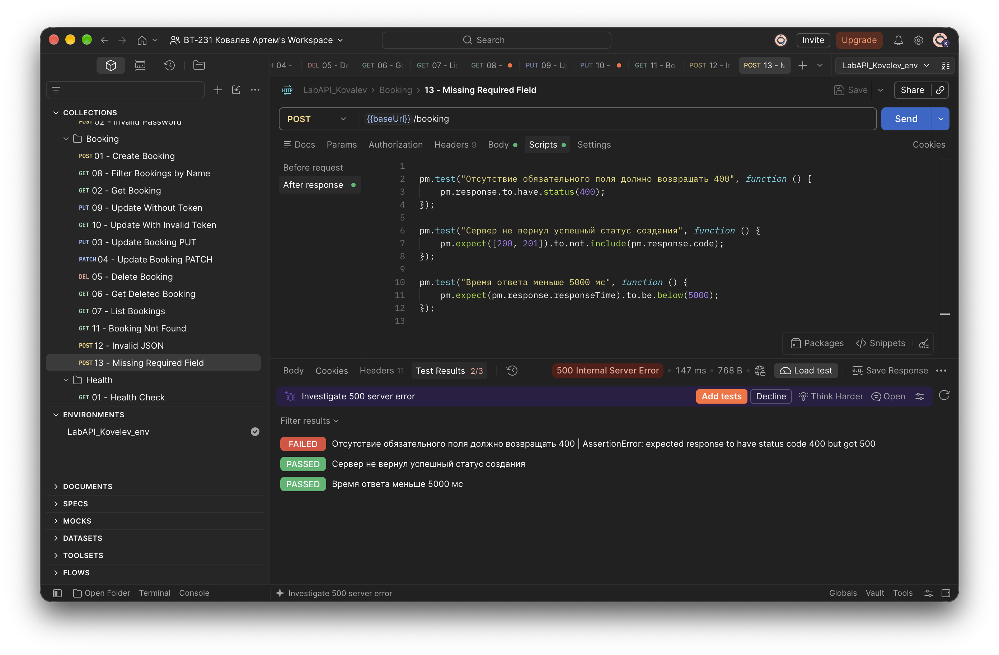
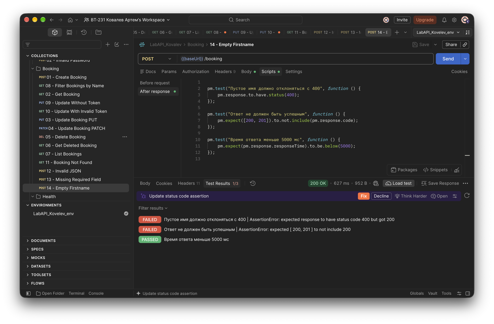
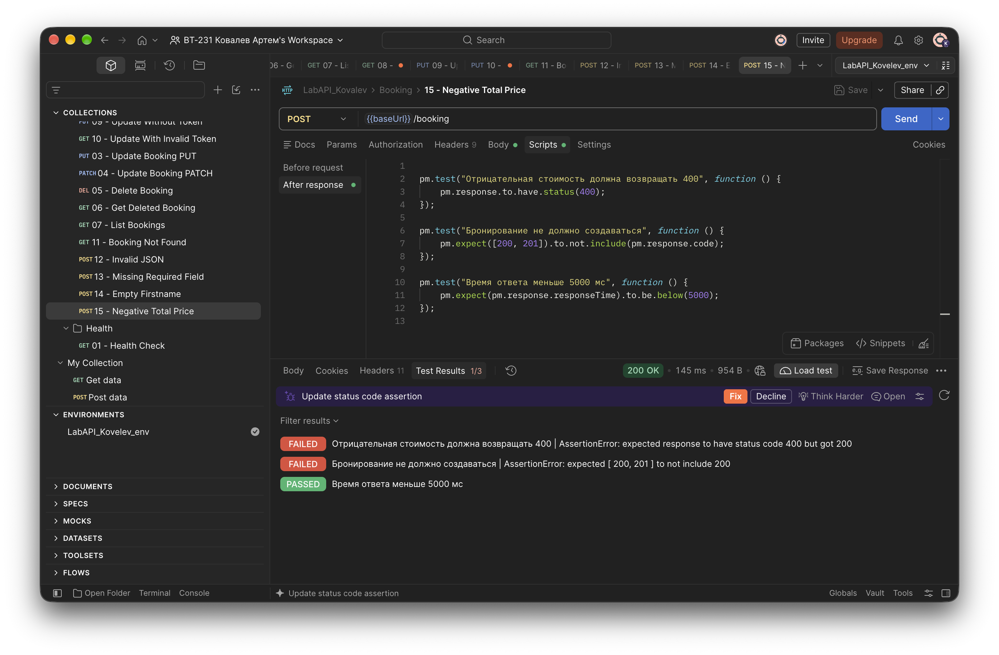
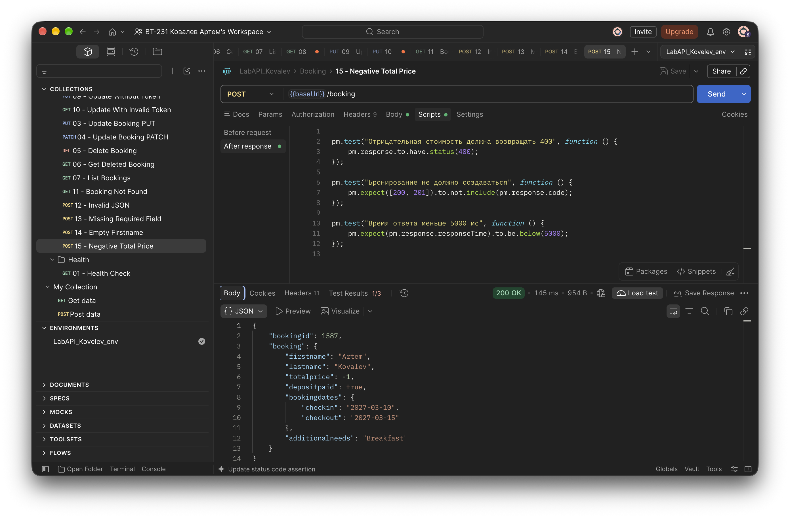
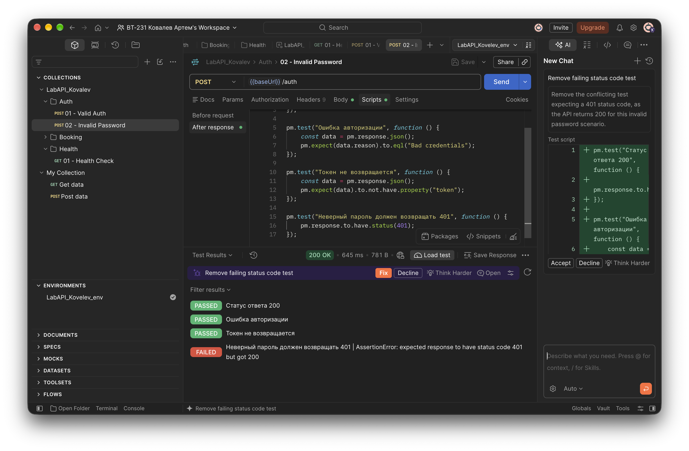
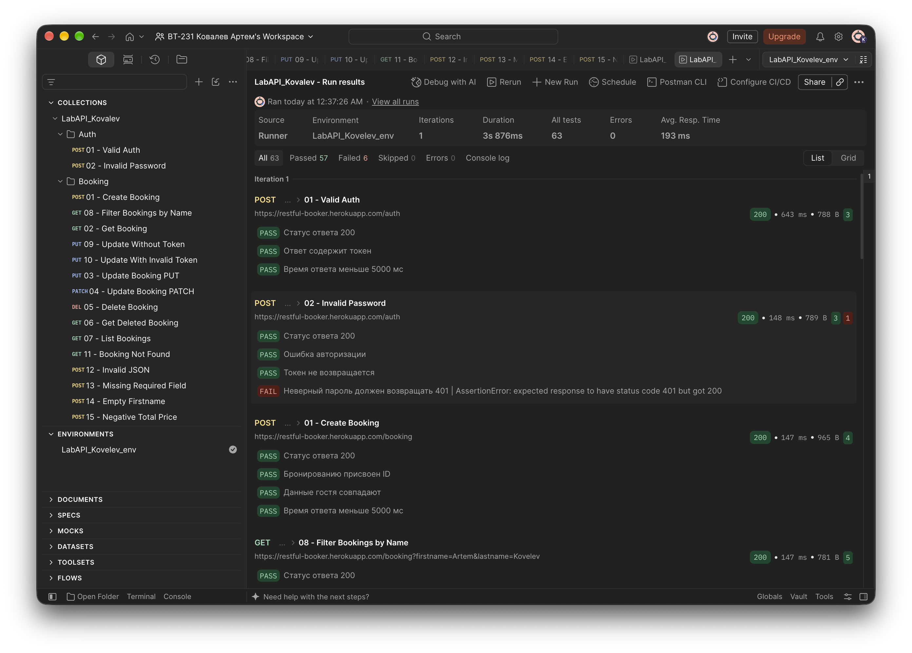
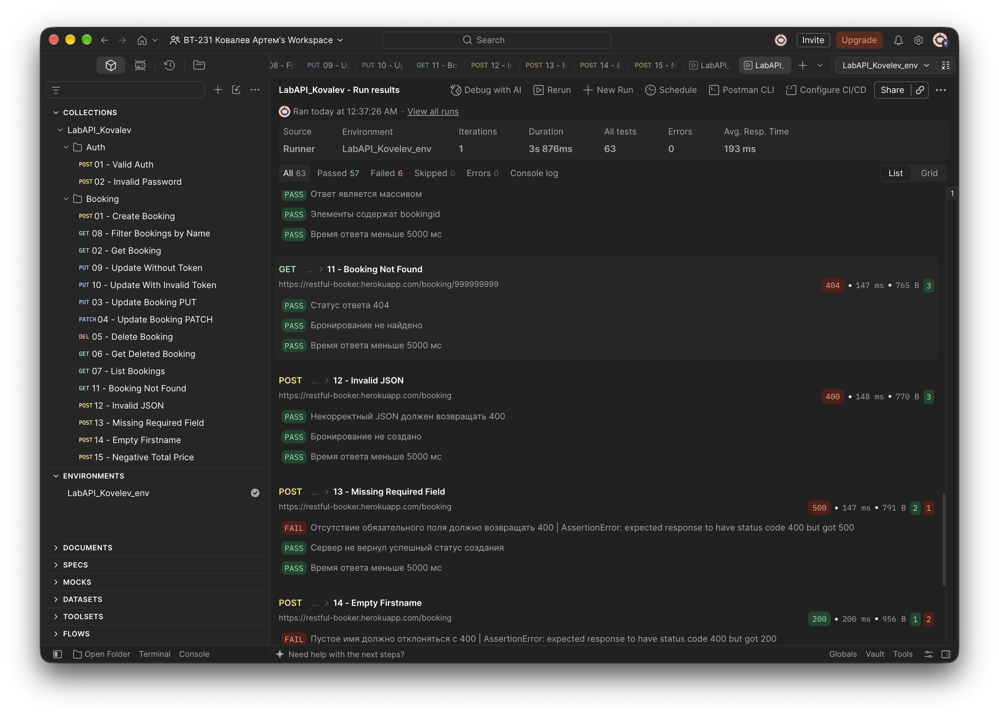
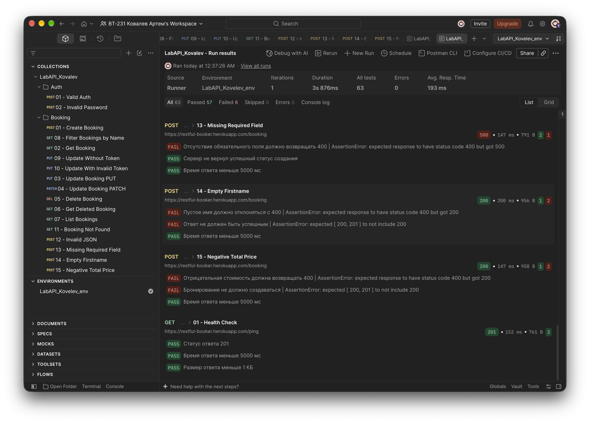

# Лабораторная работа №2
## Интеграционное тестирование REST API с использованием Postman

**Выполнил:** Ковалев Артем  
**Учебная группа:** ВТ-231  

---

## Цель работы

Освоить методы интеграционного и API-тестирования, изучить инструменты Postman для выполнения HTTP-запросов и разработки автоматизированных проверок. На практике исследовать работу REST API, выполнить позитивные, негативные и граничные тесты, определить особенности поведения сервера и проанализировать выявленные расхождения.

**Тестируемый сервис:** [Restful-Booker](https://restful-booker.herokuapp.com)

**Документация API:** https://restful-booker.herokuapp.com/apidoc/index.html

## 1. Характеристика тестируемого API

Restful-Booker представляет собой открытый учебный веб-сервис, предназначенный для работы с бронированиями. Взаимодействие с ним осуществляется посредством HTTP-запросов.

В ходе лабораторной работы исследовались следующие эндпоинты:

| HTTP-метод | Эндпоинт | Выполняемая операция |
|---|---|---|
| POST | `/auth` | Авторизация пользователя |
| GET | `/ping` | Проверка доступности сервера |
| GET | `/booking` | Получение списка бронирований |
| GET | `/booking/{id}` | Получение данных бронирования |
| POST | `/booking` | Создание нового бронирования |
| PUT | `/booking/{id}` | Полное обновление данных |
| PATCH | `/booking/{id}` | Частичное изменение данных |
| DELETE | `/booking/{id}` | Удаление бронирования |

Тестирование включало проверку кодов ответа, правильности возвращаемых данных, обработки некорректных параметров, авторизации и скорости ответа сервера.

## 2. Подготовка тестового окружения

Для выполнения лабораторной работы в Postman была разработана коллекция `LabAPI_Kovelev`, содержащая **18 HTTP-запросов**.

Запросы распределены по трём тематическим папкам:

- **Auth** — проверка механизмов авторизации;
- **Booking** — создание, получение, обновление, удаление и проверка данных бронирования;
- **Health** — проверка работоспособности веб-сервиса.

Создано отдельное окружение `LabAPI_Kovelev_env`.

### 2.1. Переменные окружения

| Переменная | Значение или назначение |
|---|---|
| `baseUrl` | `https://restful-booker.herokuapp.com` |
| `token` | Токен для авторизованных запросов |
| `bookingId` | Идентификатор созданного бронирования |

Переменные `token` и `bookingId` заполняются автоматически при выполнении соответствующих запросов.

При отправке PUT, PATCH и DELETE используется заголовок авторизации `Cookie: token={{token}}`.

Для выполнения отрицательных проверок были подготовлены запросы без токена и с заведомо неверным токеном.

### 2.2. Автоматизация работы с переменными

После успешного POST-запроса `/auth` ответ анализируется JavaScript-скриптом. Если в ответе присутствует токен, его значение записывается в переменную окружения:

`const data = pm.response.json();`

`if (data.token) pm.environment.set("token", data.token);`

Аналогично после создания бронирования выполняется сохранение идентификатора:

`const data = pm.response.json();`

`if (data.bookingid) pm.environment.set("bookingId", data.bookingid);`

Это позволяет объединить запросы в последовательный сценарий и не вводить идентификатор вручную.

Автоматизированные проверки реализованы на вкладке **Scripts → After response** с использованием функций `pm.test()` и `pm.expect()`.

## 3. Перечень разработанных запросов

В коллекцию вошли позитивные, негативные и граничные сценарии.

| № | Наименование запроса | Метод | Назначение |
|---|---|---|---|
| 1 | 01 - Valid Auth | POST | Авторизация с корректными данными |
| 2 | 02 - Invalid Password | POST | Авторизация с неверным паролем |
| 3 | 01 - Create Booking | POST | Создание нового бронирования |
| 4 | 08 - Filter Bookings by Name | GET | Фильтрация по имени и фамилии |
| 5 | 02 - Get Booking | GET | Получение бронирования по ID |
| 6 | 09 - Update Without Token | PUT | Обновление без авторизации |
| 7 | 10 - Update With Invalid Token | PUT | Обновление с неверным токеном |
| 8 | 03 - Update Booking PUT | PUT | Полное обновление бронирования |
| 9 | 04 - Update Booking PATCH | PATCH | Частичное обновление |
| 10 | 05 - Delete Booking | DELETE | Удаление бронирования |
| 11 | 06 - Get Deleted Booking | GET | Проверка удаления записи |
| 12 | 07 - List Bookings | GET | Получение списка бронирований |
| 13 | 11 - Booking Not Found | GET | Запрос несуществующего ID |
| 14 | 12 - Invalid JSON | POST | Отправка синтаксически неверного JSON |
| 15 | 13 - Missing Required Field | POST | Отсутствие обязательного поля |
| 16 | 14 - Empty Firstname | POST | Пустое значение имени |
| 17 | 15 - Negative Total Price | POST | Отрицательная стоимость |
| 18 | 01 - Health Check | GET | Проверка доступности API |

Все запросы содержат автоматические проверки. Общее количество проверок — **63**.

## 4. Таблицы тест-кейсов

### 4.1. Позитивные сценарии

| ID | Проверяемая операция | Ожидаемый результат | Фактический результат | Итог |
|---|---|---|---|---|
| TC-P01 | Авторизация | 200, токен получен | 200, токен возвращён | PASSED |
| TC-P02 | Создание бронирования | 200, возвращён bookingId | 200, ID получен | PASSED |
| TC-P03 | Поиск по имени | 200, созданный ID присутствует | 200, нужный ID найден | PASSED |
| TC-P04 | Получение по ID | 200, данные совпадают | 200, данные соответствуют | PASSED |
| TC-P05 | Полное обновление PUT | 200, изменения сохранены | 200, поля обновлены | PASSED |
| TC-P06 | Частичное обновление PATCH | 200, изменены выбранные поля | 200, изменения подтверждены | PASSED |
| TC-P07 | Удаление бронирования | 201, удаление подтверждено | 201 Created | PASSED |
| TC-P08 | Получение после удаления | 404, запись отсутствует | 404 Not Found | PASSED |
| TC-P09 | Получение списка | 200, массив JSON | 200, массив получен | PASSED |
| TC-P10 | Проверка `/ping` | 201, сервис отвечает | 201 Created | PASSED |

**Результат:** основные операции REST API выполняются корректно в рамках заданных проверок.

### 4.2. Негативные сценарии

| ID | Тестируемое условие | Ожидаемый результат | Полученный результат | Итог |
|---|---|---|---|---|
| TC-N01 | Неверный пароль | 401 Unauthorized | 200, Bad credentials | FAILED |
| TC-N02 | PUT без токена | 403 Forbidden | 403 Forbidden | PASSED |
| TC-N03 | PUT с недействительным токеном | 403 Forbidden | 403 Forbidden | PASSED |
| TC-N04 | Несуществующий ID | 404 Not Found | 404 Not Found | PASSED |
| TC-N05 | Некорректный JSON | 400 Bad Request | 400 Bad Request | PASSED |
| TC-N06 | Отсутствует firstname | 400 Bad Request | 500 Internal Server Error | FAILED |

В тесте TC-N01 авторизация фактически отклонена, поскольку токен не выдаётся. Неуспешная проверка относится к ожиданию HTTP-статуса 401.

В тесте TC-N06 обнаружен ответ сервера 500 при отсутствии поля, необходимого для создания бронирования.

### 4.3. Граничные сценарии

| ID | Входные данные | Ожидаемый результат | Фактический результат | Итог |
|---|---|---|---|---|
| TC-B01 | `firstname = ""` | 400 Bad Request | 200 OK | FAILED |
| TC-B02 | `totalprice = -1` | 400 Bad Request | 200 OK, бронирование создано | FAILED |

Эти тесты основаны на предполагаемых бизнес-правилах: имя гостя не должно быть пустым, а стоимость бронирования не должна принимать отрицательные значения.

Полученные результаты демонстрируют, что сервис не отклонил такие значения. Для официального подтверждения дефектов требуется сопоставить поведение с бизнес-требованиями.

## 5. Примеры автоматизированных проверок

В качестве основного механизма проверки использовались JavaScript-утверждения Postman.

**Проверка HTTP-статуса:**

`pm.response.to.have.status(200);`

**Ограничение времени ответа:**

`pm.expect(pm.response.responseTime).to.be.below(5000);`

**Проверка наличия идентификатора:**

`pm.expect(data.bookingid).to.be.a("number");`

**Проверка структуры ответа:**

`pm.expect(data).to.be.an("array");`

**Проверка запрета доступа:**

`pm.response.to.have.status(403);`

Также были реализованы проверки конкретных значений полей бронирования, соответствия дат, стоимости, имени гостя и наличия созданного идентификатора в результатах фильтрации.

Использование подобных проверок позволяет установить не только факт получения ответа от сервера, но и соответствие этого ответа условиям тестового сценария.

## 6. Анализ фактического поведения API

### 6.1. Сводная таблица расхождений

| № | Проверка | Ожидалось | Получено | Характер расхождения |
|---|---|---|---|---|
| 1 | Неверный пароль | 401 | 200 | Особенность обработки авторизации |
| 2 | Отсутствующее firstname | 400 | 500 | Возможная ошибка серверной валидации |
| 3 | Пустое firstname | 400 | 200 | Не проверяется непустое значение |
| 4 | Отрицательное totalprice | 400 | 200 | Принимается отрицательная стоимость |

Всего обнаружено **4 сценария с расхождениями**, которым соответствуют 6 неуспешных автоматических проверок.

Часть различий может быть связана с особенностями реализации учебного сервиса, а не с нарушением документированного контракта API.

## 7. Описание обнаруженных проблем

### BUG-01. Внутренняя ошибка при отсутствии firstname

**Запрос:** `POST /booking`

**Тип:** негативное тестирование.

**Описание проблемы:** при отправке корректного по синтаксису JSON без поля `firstname` сервис возвращает внутреннюю ошибку.

**Шаги воспроизведения:**

1. Открыть запрос `13 - Missing Required Field`.
2. Установить `Content-Type: application/json`.
3. Передать JSON с остальными полями бронирования, исключив `firstname`.
4. Выполнить запрос.
5. Проверить HTTP-статус и результаты автоматических проверок.

**Ожидаемый результат:** 400 Bad Request, отклонение некорректного набора данных.

**Фактический результат:** 500 Internal Server Error.

**Вывод:** сервис возвращает серверную ошибку вместо предполагаемого корректного отказа при нарушении требований к входным данным. Это указывает на возможный недостаток валидации или обработки исключений.

### BUG-02. Принимается пустое имя гостя

**Запрос:** `POST /booking`

**Тип:** граничное тестирование.

**Описание проблемы:** сервис разрешает создание бронирования при передаче пустой строки в поле имени.

**Шаги воспроизведения:**

1. Открыть запрос `14 - Empty Firstname`.
2. Передать корректный JSON с `"firstname": ""`.
3. Указать остальные поля бронирования.
4. Отправить запрос и проверить статус.

**Ожидаемый результат:** 400 Bad Request при условии, что пустое имя запрещено бизнес-правилами.

**Фактический результат:** 200 OK. Сервер принимает запрос.

**Вывод:** проверка непустого имени на стороне API не проявилась. Требуется уточнение требований к обязательным строковым полям.

### BUG-03. Возможность создания бронирования с отрицательной стоимостью

**Запрос:** `POST /booking`

**Тип:** граничное тестирование.

**Описание проблемы:** API не отклоняет отрицательное числовое значение стоимости.

**Шаги воспроизведения:**

1. Открыть запрос `15 - Negative Total Price`.
2. Установить в теле запроса `"totalprice": -1`.
3. Остальные данные заполнить корректными значениями.
4. Выполнить запрос.
5. Проверить возвращённый JSON.

**Ожидаемый результат:** 400 Bad Request, если стоимость должна быть неотрицательной.

**Фактический результат:** 200 OK. Создано бронирование с идентификатором `1587`, значение `totalprice` в ответе равно `-1`.

**Вывод:** отрицательная стоимость была фактически принята и отражена в созданном объекте бронирования. При наличии соответствующего бизнес-ограничения это является ошибкой валидации.

### OBS-01. Особенность ответа при неверном пароле

**Запрос:** `POST /auth`

**Тип:** негативное тестирование.

**Шаги воспроизведения:**

1. Открыть запрос `02 - Invalid Password`.
2. Ввести корректное имя пользователя и неверный пароль.
3. Отправить запрос.
4. Проверить статус и тело ответа.

**Ожидаемый результат по принятому тестовому сценарию:** HTTP 401 Unauthorized.

**Фактический результат:** HTTP 200 OK, тело содержит `reason: Bad credentials`, токен отсутствует.

**Вывод:** сервер отклоняет неправильные учётные данные, но использует HTTP 200. Это отличие от принятого тестового ожидания и особенность реализации механизма авторизации.

## 8. Итоговое выполнение Collection Runner

После разработки и настройки запросов был выполнен общий запуск коллекции `LabAPI_Kovelev`.

Все 18 запросов выполнялись последовательно в рамках одной итерации.

### 8.1. Результаты запуска

| Показатель | Значение |
|---|---|
| Коллекция | LabAPI_Kovelev |
| Окружение | LabAPI_Kovelev_env |
| Количество запросов | 18 |
| Итераций | 1 |
| Автоматических проверок | 63 |
| Успешных проверок | 57 |
| Неуспешных проверок | 6 |
| Пропущенных проверок | 0 |
| Ошибок выполнения Runner | 0 |
| Длительность запуска | 3,876 с |
| Среднее время ответа | 193 мс |
| Процент успешных проверок | 90,48% |

**Итог:** 57 проверок завершились успешно, 6 зафиксировали несоответствие фактического результата заданным ожиданиям.

Важно учитывать, что количество неуспешных проверок не соответствует количеству отдельных проблем. В сценариях с пустым именем и отрицательной стоимостью по две проверки контролировали близкие условия: ожидаемый HTTP-статус и отсутствие успешного ответа.

### 8.2. Скриншоты выполнения

**Рисунок 1 — Общие результаты выполнения коллекции.**

**Рисунок 2 — Негативные сценарии и обработка некорректных данных.**

**Рисунок 3 — Результаты граничных тестов и выявленные расхождения.**

### 8.3. Анализ успешных проверок

В ходе выполнения коллекции подтверждены:

- возможность авторизации с корректными учётными данными;
- создание бронирования и сохранение его идентификатора;
- поиск созданного бронирования по имени и фамилии;
- получение данных по ID;
- выполнение полного и частичного обновления;
- запрет изменения без корректного токена;
- успешное удаление и последующий ответ 404;
- возвращение корректных HTTP-ответов для несуществующих записей;
- обработка синтаксически некорректного JSON;
- работоспособность служебного эндпоинта `/ping`.

Время ответа всех проверенных запросов в итоговом прогоне не превышало заданного ограничения 5000 мс.

## 9. Передаваемые материалы

В каталоге второй лабораторной находятся:

**1. `LabAPI_Kovelev.postman_collection.json`**

Экспортированная коллекция Postman. Содержит 18 запросов, их настройки, тела, сценарии проверок и организацию по папкам.

**2. `LabAPI_Kovalev_env.postman_environment.json`**

Файл окружения Postman с переменными `baseUrl`, `token`, `bookingId`. Значения токена и идентификатора в экспортированной версии очищены.

**3. Папка `Screenshots`**

Содержит изображения результатов тестирования, общего запуска Runner и выявленных расхождений.

### Порядок запуска

1. Импортировать коллекцию JSON в Postman.
2. Импортировать файл окружения.
3. Выбрать окружение `LabAPI_Kovelev_env`.
4. Убедиться, что переменная `baseUrl` задана.
5. Открыть Collection Runner.
6. Выбрать функциональный запуск, одну итерацию и все 18 запросов.
7. Отключить остановку при ошибке, чтобы выполнить все сценарии.
8. Запустить коллекцию и изучить результаты.

Неуспешные проверки в негативных и граничных сценариях необходимо анализировать с учётом ожидаемых и фактических HTTP-ответов.

## 10. Общий вывод

В ходе лабораторной работы проведено интеграционное и функциональное тестирование REST API Restful-Booker с использованием Postman.

Была разработана коллекция из 18 HTTP-запросов, охватывающая авторизацию, проверку доступности сервиса, операции создания, чтения, изменения и удаления бронирований, а также негативные и граничные сценарии.

Для автоматизации использовались JavaScript-скрипты, позволяющие анализировать HTTP-ответы, проверять поля объектов и динамически сохранять токен и идентификатор бронирования.

При итоговом выполнении Collection Runner получено **63 автоматические проверки: 57 PASSED и 6 FAILED**. Основной CRUD-сценарий выполнен успешно, а негативные и граничные тесты позволили зафиксировать четыре расхождения с принятыми ожиданиями.

Наиболее значимыми результатами являются ответ 500 при отсутствии поля `firstname`, успешное принятие пустого имени и создание бронирования с отрицательной стоимостью.

Работа продемонстрировала практическую значимость автоматизированного тестирования API: оно помогает оценивать корректность бизнес-операций, обнаруживать нестандартное поведение сервера и формировать воспроизводимые сценарии проверки качества программного обеспечения.