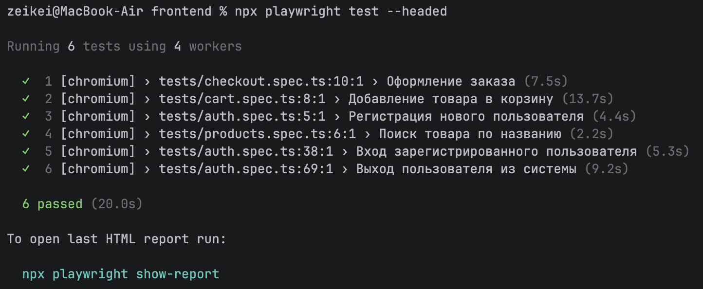
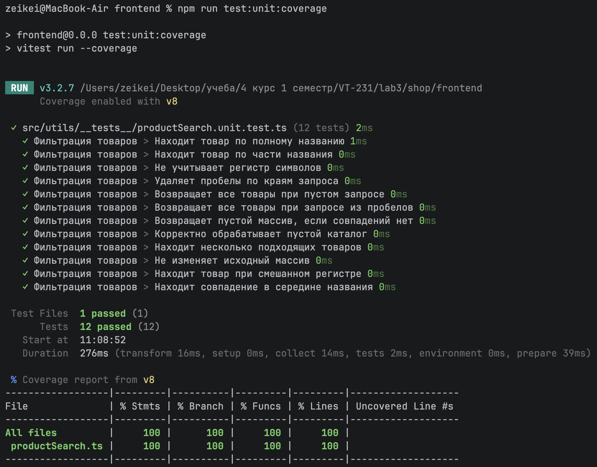
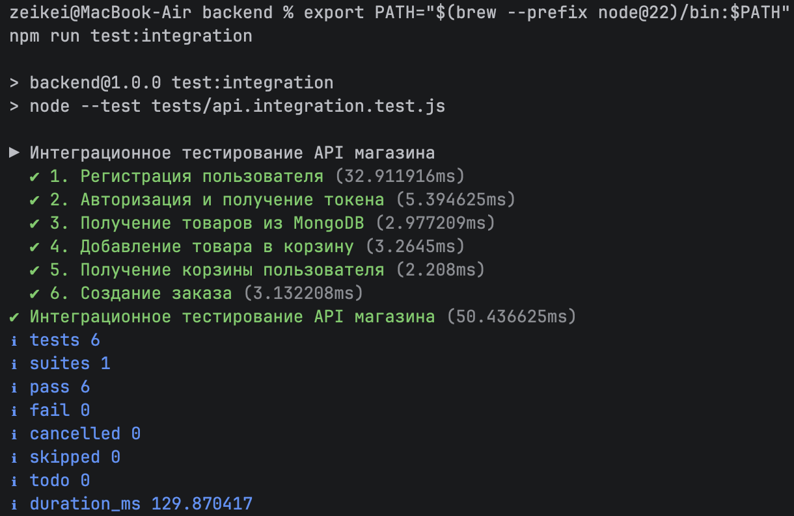
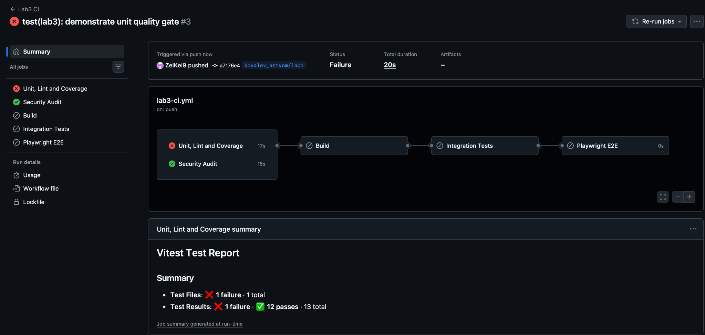
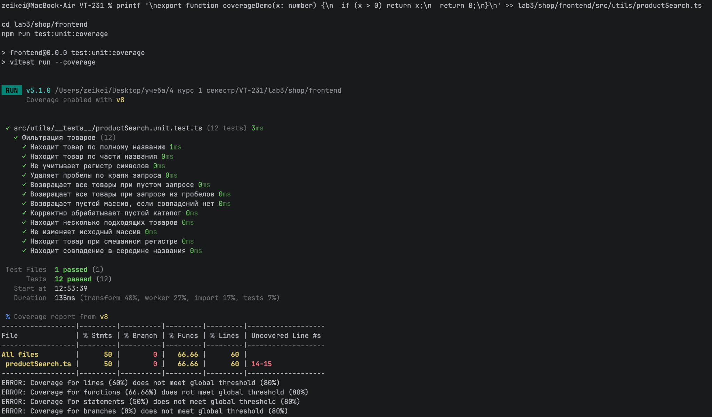
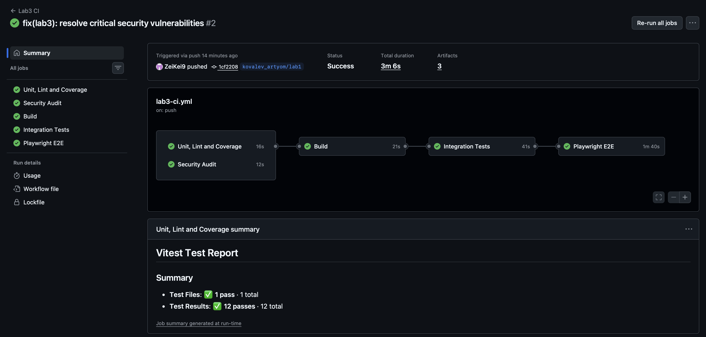

# Лабораторная работа №4

## Автоматизация UI-тестов и построение CI/CD-пайплайна с блокирующими quality gates

**Выполнил:** Ковалев Артем  
**Группа:** ВТ-231

[](https://github.com/d26dodenko/VT-231/actions/workflows/lab3-ci.yml)

---

## 1. Цель работы

Освоить UI-автоматизацию, паттерны проектирования тестов, встраивание тестов в пайплайн непрерывной интеграции и настройку блокирующих quality gates, при которых падение тестов останавливает сборку и релиз.

## 2. Описание проекта

Для выполнения лабораторной работы использован интернет-магазин **Clothify**, построенный на React и Node.js.

Приложение позволяет пользователям регистрироваться, авторизоваться, просматривать и искать товары, добавлять их в корзину и оформлять заказы.

Для тестирования подготовлены frontend, backend и база данных MongoDB.

### Используемые технологии

| Технология | Назначение |
|---|---|
| React, TypeScript, Vite | Frontend приложения |
| Node.js, Express | Backend и REST API |
| MongoDB, Mongoose | База данных |
| Playwright | Автоматизированное E2E-тестирование |
| Vitest | Модульное тестирование |
| Node.js Test Runner | Интеграционное тестирование |
| ESLint | Статический анализ кода |
| npm audit | Проверка безопасности зависимостей |
| GitHub Actions | CI/CD-пайплайн |

Исходный код приложения расположен в каталоге `shop/`.

## 3. Часть 1. Автоматизация UI-тестирования

Для автоматизации пользовательских сценариев использован **Playwright** с браузером Chromium.

### 3.1. Реализованные E2E-тесты

| № | Сценарий | Результат |
|---|---|---|
| 1 | Регистрация пользователя | PASSED |
| 2 | Вход в систему | PASSED |
| 3 | Поиск товара | PASSED |
| 4 | Добавление товара в корзину | PASSED |
| 5 | Оформление заказа | PASSED |
| 6 | Выход из системы | PASSED |

Тесты выполняют действия через интерфейс браузера и проверяют результат работы приложения.

**Итог: 6 из 6 E2E-тестов пройдены.**



### 3.2. Применение Page Object Model

В работе использован паттерн **Page Object Model (POM)**.

Его основная идея заключается в разделении логики взаимодействия со страницами и самих тестовых сценариев.

Для этого созданы отдельные классы:

- `AuthPage.ts` — регистрация, авторизация и выход;
- `ProductsPage.ts` — каталог товаров и поиск;
- `CartPage.ts` — работа с корзиной;
- `CheckoutPage.ts` — оформление заказа.

Исходный код Page Object:

- [AuthPage.ts](shop/frontend/pages/AuthPage.ts)
- [ProductsPage.ts](shop/frontend/pages/ProductsPage.ts)
- [CartPage.ts](shop/frontend/pages/CartPage.ts)
- [CheckoutPage.ts](shop/frontend/pages/CheckoutPage.ts)

Исходный код E2E-тестов:

- [auth.spec.ts](shop/frontend/tests/auth.spec.ts)
- [products.spec.ts](shop/frontend/tests/products.spec.ts)
- [cart.spec.ts](shop/frontend/tests/cart.spec.ts)
- [checkout.spec.ts](shop/frontend/tests/checkout.spec.ts)

Применение POM позволяет повторно использовать методы взаимодействия с элементами страниц, уменьшать дублирование кода и упрощать поддержку тестов.

## 4. Часть 2. Пирамида тестирования

Для приложения реализованы три уровня автоматизированного тестирования: Unit, Integration и E2E.

### 4.1. Схема пирамиды

```text
                  /\
                 /  \
                / E2E\
               /  6   \
              /--------\
             /          \
            / Integration\
           /      6       \
          /----------------\
         /                  \
        /     Unit — 12      \
       /______________________\
```

### 4.2. Распределение тестов

| Уровень | Количество | Доля | Результат |
|---|---:|---:|---|
| Unit | 12 | 50% | PASSED |
| Integration | 6 | 25% | PASSED |
| E2E | 6 | 25% | PASSED |
| **Всего** | **24** | **100%** | **PASSED** |

### 4.3. Unit-тестирование

Модульные тесты реализованы с помощью Vitest.

Объект тестирования — функция фильтрации товаров из модуля `productSearch.ts`.

Проверяются:

1. Поиск по полному названию.
2. Поиск по части названия.
3. Поиск без учёта регистра.
4. Обработка пробелов в запросе.
5. Пустой поисковый запрос.
6. Запрос только из пробелов.
7. Отсутствие совпадений.
8. Пустой каталог.
9. Несколько подходящих товаров.
10. Неизменность исходного массива.
11. Смешанный регистр символов.
12. Совпадение в середине названия.

**Результат: 12/12 PASSED.**

Покрытие измерялось с помощью V8.

| Метрика | Покрытие |
|---|---:|
| Statements | 100% |
| Branches | 100% |
| Functions | 100% |
| Lines | 100% |

Установленный минимальный порог покрытия — **80%**.

Покрытие 100% относится к модулю `productSearch.ts`, включённому в конфигурацию Vitest, а не ко всему приложению.



### 4.4. Интеграционное тестирование

Для интеграционного тестирования использован встроенный Node.js Test Runner.

Тесты проверяют взаимодействие REST API с базой данных MongoDB.

Реализованы проверки:

1. Регистрация пользователя через API.
2. Авторизация и получение JWT.
3. Получение списка товаров.
4. Добавление товара в корзину.
5. Получение содержимого корзины.
6. Создание заказа.

Тесты отправляют реальные HTTP-запросы, проверяют ответы сервера и взаимодействие с базой данных.

**Результат: 6/6 PASSED.**



### 4.5. E2E-тестирование

E2E-тестирование реализовано через Playwright.

Тесты проверяют приложение со стороны пользователя: открытие страниц, ввод данных, нажатие кнопок, работу корзины и оформление заказа.

**Результат: 6/6 PASSED.**

### 4.6. Обоснование пирамиды

Unit-тесты составляют основание пирамиды, поскольку проверяют отдельные функции, выполняются быстро и позволяют рано обнаруживать ошибки.

Интеграционные тесты проверяют правильность взаимодействия компонентов приложения: сервера, API и базы данных.

E2E-тесты проверяют полные пользовательские сценарии. Они требуют запуска браузера и приложения, поэтому выполняются дольше.

В работе наибольшее количество тестов относится к уровню Unit — 12 тестов. На уровнях Integration и E2E реализовано по 6 тестов.

Такое распределение позволяет сочетать скорость проверок с тестированием реальных пользовательских сценариев.

## 5. Часть 3. CI/CD и Quality Gates

Для автоматического запуска проверок настроен GitHub Actions.

Файл конфигурации:

[.github/workflows/lab3-ci.yml](../.github/workflows/lab3-ci.yml)

Пайплайн запускается автоматически при событиях `push` и `pull_request`.

### 5.1. Структура CI/CD-пайплайна

```text
                 PUSH / PR
                    |
          +---------+---------+
          |                   |
          v                   v
    Unit + Lint +         Security
      Coverage             Audit
          |                   |
          +---------+---------+
                    |
                    v
                  Build
                    |
                    v
             Integration
                Tests
                    |
                    v
              Playwright
                  E2E
```

### 5.2. Этапы пайплайна

| Этап | Выполняемые действия |
|---|---|
| Unit, Lint and Coverage | ESLint, 12 Unit-тестов, проверка покрытия |
| Security Audit | Проверка зависимостей frontend и backend |
| Build | Production-сборка приложения |
| Integration Tests | 6 API-тестов с MongoDB |
| Playwright E2E | 6 браузерных тестов в Chromium |

Для выполнения проверок в GitHub Actions используется Node.js 22.

Для интеграционных и E2E-тестов автоматически подготавливаются MongoDB, тестовые товары и необходимые серверы.

### 5.3. Блокирующие Quality Gates

**Unit Quality Gate**

Если модульный тест завершается с ошибкой, соответствующее задание CI получает статус Failed.

**Coverage Quality Gate**

Минимально допустимое покрытие проверяемого модуля составляет 80%.

При недостаточном покрытии Vitest завершает выполнение с ошибкой.

**Security Quality Gate**

Зависимости анализируются через `npm audit --audit-level=critical`.

При обнаружении критических уязвимостей проверка завершается ошибкой.

Для JavaScript-проекта применяется npm audit вместо Python-инструментов Bandit/Safety.

**Build Gate**

Этап Build запускается только после успешного выполнения Unit, Lint and Coverage и Security Audit.

При ошибке обязательной проверки дальнейшие этапы блокируются.

Зависимости между заданиями реализованы через `needs` в GitHub Actions.

## 6. Практическая проверка Quality Gates

Для подтверждения работы блокирующих проверок были проведены отдельные эксперименты.

### 6.1. Проверка Unit Quality Gate

В набор Unit-тестов временно добавлен тест с заведомо ошибочным утверждением.

Результат:

- 12 Unit-тестов прошли успешно;
- 1 Unit-тест завершился ошибкой;
- Unit, Lint and Coverage — Failed;
- Security Audit — Success;
- Build — Skipped;
- Integration Tests — Skipped;
- Playwright E2E — Skipped.

Таким образом, ошибка Unit-теста заблокировала сборку и дальнейшее тестирование.



После проверки намеренно ошибочный тест удалён.

### 6.2. Проверка Coverage Quality Gate

Для проверки порога покрытия в модуль `productSearch.ts` временно добавлена функция, не используемая тестами.

Все 12 Unit-тестов прошли успешно, однако покрытие уменьшилось.

| Метрика | Фактическое покрытие | Требование |
|---|---:|---:|
| Statements | 50% | 80% |
| Branches | 0% | 80% |
| Functions | 66,66% | 80% |
| Lines | 60% | 80% |

Vitest вывел ошибки о несоответствии покрытия установленным порогам и завершился с ненулевым кодом.

Это подтвердило работу Coverage Quality Gate.



После эксперимента исходный код был восстановлен, а покрытие проверяемого модуля снова составило 100%.

### 6.3. Проверка Security Quality Gate

При первоначальном запуске GitHub Actions проверка зависимостей обнаружила критические уязвимости.

Результат:

- Unit, Lint and Coverage — Success;
- Security Audit — Failed;
- Build — Skipped;
- Integration Tests — Skipped;
- Playwright E2E — Skipped.

Это подтвердило работу блокирующего Security Quality Gate.

Для устранения проблемы были обновлены зависимости проекта, в том числе библиотека `form-data`.

После исправления критические уязвимости больше не обнаруживались. Проверка Security Audit успешно прошла.

Отдельный скриншот неуспешного Security Audit не прикладывается: результат сохраняется в истории запусков GitHub Actions.

### 6.4. Успешный запуск CI/CD

После устранения ошибок пайплайн успешно выполнил все пять заданий:

1. Unit, Lint and Coverage — Success.
2. Security Audit — Success.
3. Build — Success.
4. Integration Tests — Success.
5. Playwright E2E — Success.

**Результат: 5/5 SUCCESS.**

Продолжительность успешного запуска: **3 минуты 6 секунд**.



### 6.5. Отчёты и артефакты

GitHub Actions сохраняет результаты автоматизированных проверок.

В пайплайне предусмотрены:

- Coverage-отчёт по Unit-тестам;
- отчёт интеграционного тестирования;
- отчёт Playwright E2E.

Отчёты доступны через соответствующие задания и артефакты запусков GitHub Actions.

### 6.6. Branch Protection

Для запрета слияния непроверенного кода в `main` в GitHub предусмотрен механизм Branch Protection или Rulesets.

Он позволяет установить обязательное успешное прохождение CI перед слиянием pull request.

В данном проекте CI настроен, однако включение Branch Protection зависит от административных прав на репозиторий.

Фактическое включение правила защиты ветки необходимо проверять отдельно в настройках GitHub.

## 7. Запуск тестов

Для локального выполнения используется Node.js 22.

Перед интеграционными и E2E-тестами необходимо запустить MongoDB, backend и frontend, а также подготовить тестовые данные.

### 7.1. Модульные тесты

Из папки `lab3/shop/frontend`:

```bash
npm ci
npx vitest run
```

### 7.2. Проверка покрытия

```bash
npm run test:unit:coverage
```

### 7.3. Статический анализ и сборка

```bash
npm run lint
npm run build
```

### 7.4. Интеграционные тесты

Из папки `lab3/shop/backend` при работающем backend и MongoDB:

```bash
npm ci
node --test tests/api.integration.test.js
```

### 7.5. E2E-тесты

Из папки `lab3/shop/frontend` при запущенном приложении:

```bash
npx playwright install chromium
npx playwright test --workers=1
```

### 7.6. Проверка зависимостей

Из папок frontend и backend отдельно:

```bash
npm audit --audit-level=critical
```

В CI подготовка окружения и запуск проверок выполняются автоматически.

## 8. Итоговые результаты

| Проверка | Результат |
|---|---|
| Unit-тестирование | 12/12 PASSED |
| Integration-тестирование | 6/6 PASSED |
| E2E-тестирование | 6/6 PASSED |
| Общее количество тестов | 24 |
| Покрытие productSearch.ts | 100% |
| Порог Coverage Gate | 80% |
| ESLint | PASSED |
| Production Build | PASSED |
| Security Audit | PASSED |
| Unit Quality Gate | Проверен |
| Coverage Quality Gate | Проверен |
| Security Quality Gate | Проверен |
| GitHub Actions | 5/5 SUCCESS |

## 9. Контрольные вопросы

### 1. Что такое пирамида тестирования и почему она важна?

Пирамида тестирования — это модель распределения тестов по уровням Unit, Integration и E2E.

Unit-тесты проверяют отдельные функции, выполняются быстро и позволяют легко находить ошибки.

Integration-тесты проверяют взаимодействие нескольких компонентов системы.

E2E-тесты проверяют приложение целиком с точки зрения пользователя.

Пирамида важна, поскольку позволяет обеспечить необходимое качество приложения без чрезмерных затрат времени на медленные E2E-тесты.

В данной работе реализованы 12 Unit, 6 Integration и 6 E2E-тестов.

### 2. Какие паттерны автоматизации UI вы знаете?

Основные паттерны:

- **Page Object Model** — для каждой страницы создаётся класс с методами взаимодействия с интерфейсом.
- **Page Factory** — подход к организации и инициализации элементов страниц.
- **Screenplay** — тесты описываются через действия пользователя и задачи, которые он выполняет.
- **Data-Driven Testing** — один тест выполняется с несколькими наборами входных данных.

В лабораторной работе использован Page Object Model.

Он позволяет отделить логику работы с элементами страницы от сценариев тестирования и уменьшить повторение кода.

### 3. Что такое Quality Gates и зачем они нужны?

Quality Gates — это автоматические проверки качества, определяющие, может ли проект перейти на следующую стадию CI/CD.

Например, сборка блокируется, если тесты не пройдены, покрытие ниже установленного порога или найдены критические уязвимости.

Quality Gates предотвращают дальнейшую сборку и выпуск приложения с известными проблемами.

В работе реализованы проверки Unit, Coverage и Security.

### 4. Почему Unit-тесты запускаются на каждый коммит, Integration — после сборки, а E2E — перед релизом?

Unit-тесты выполняются быстро и проверяют отдельные функции. Их выгодно запускать при каждом изменении кода, чтобы обнаруживать ошибки как можно раньше.

Integration-тесты требуют работающих компонентов, например сервера и базы данных. Поэтому их выполняют после успешных базовых проверок и сборки.

E2E-тесты проверяют полные пользовательские сценарии в браузере и требуют больше времени и ресурсов.

Поэтому они выполняются после остальных проверок.

В данной работе используется последовательность:

**Unit + Security → Build → Integration → E2E.**

## 10. Вывод

В ходе лабораторной работы выполнена автоматизация UI-тестирования интернет-магазина Clothify с использованием Playwright и паттерна Page Object Model.

Реализована пирамида тестирования, включающая 12 модульных, 6 интеграционных и 6 E2E-тестов.

Настроен CI/CD-пайплайн GitHub Actions с автоматическим запуском тестов, проверкой качества кода, контролем покрытия и анализом безопасности зависимостей.

Экспериментально подтверждена работа блокирующих Quality Gates: падение Unit-теста, недостаточное покрытие и обнаружение критических уязвимостей приводят к ошибке соответствующей проверки.

После устранения проблем все пять этапов CI/CD успешно выполнены.

Автоматизация тестирования позволяет обнаруживать ошибки на ранних этапах и предотвращает дальнейшее продвижение кода, не прошедшего обязательные проверки качества.

**Цель лабораторной работы достигнута.**
