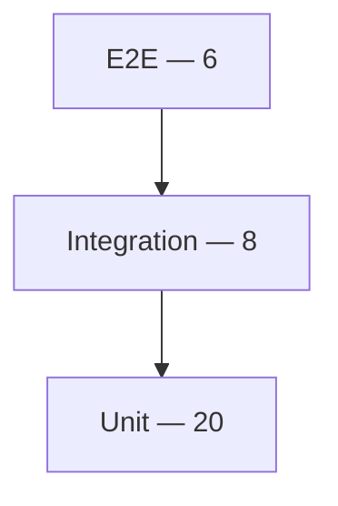
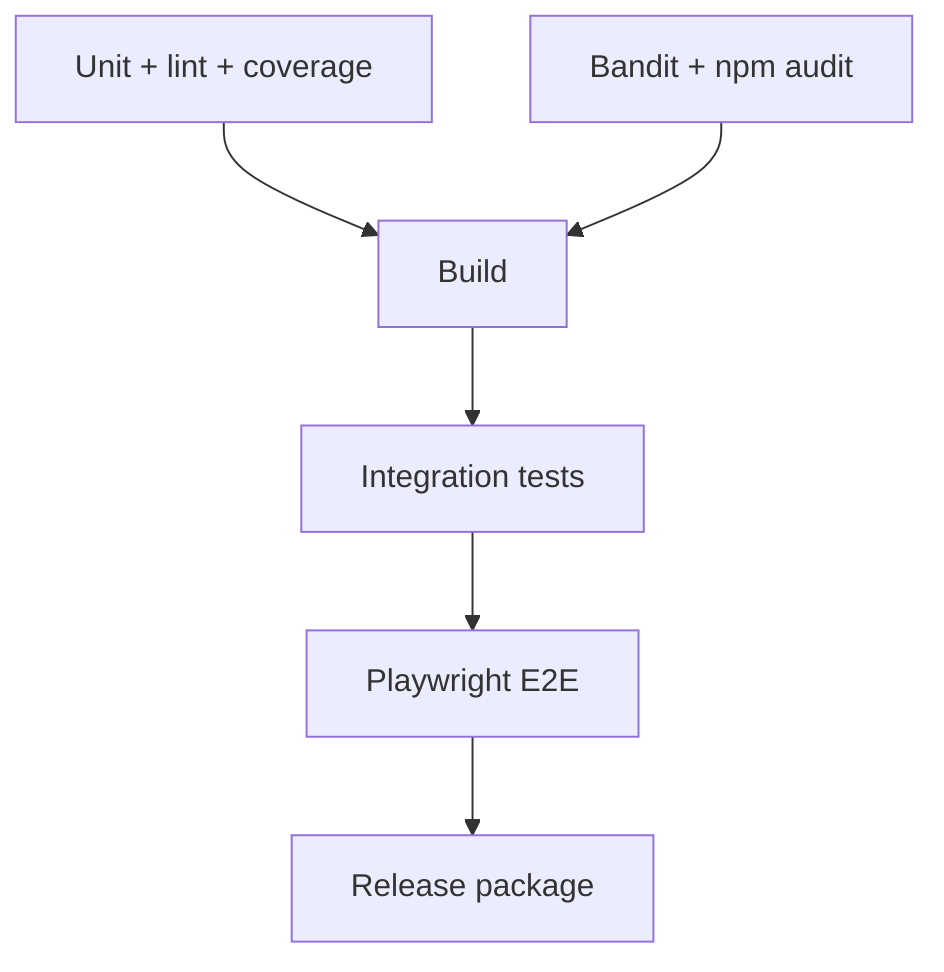

# Лабораторная работа № 3
## Автоматизация UI-тестов и построение CI/CD-пайплайна с блокирующими quality gates

**Выполнил:** Гузиев Даниил  
**Группа:** ВТ-231

[](https://github.com/d26dodenko/VT-231/actions/workflows/ci.yml?query=branch%3Aguziev_daniil%2Flab1)

## Цель работы

Освоить автоматизацию UI-тестов, применение Page Object, распределение тестов по пирамиде и настройку CI/CD с блокирующими проверками качества.

## 1. Тестируемое приложение

В качестве основы используется учебный интернет-магазин Clothify из задания: [edgistify-Assignment](https://github.com/Sajid788/edgistify-Assignment). Исходники взяты из ранее предоставленной учебной копии этого проекта, а не написаны с нуля. Стек: React/TypeScript, Express/Node.js, MongoDB. В рамках лабораторной выделен модуль расчёта корзины, подготовлены другие тестовые товары, уточнена передача изображений и очистка локальной сессии при выходе. Авторство исходного магазина сохраняется за его автором.

| Компонент | Адрес / назначение |
|---|---|
| Frontend | http://127.0.0.1:5173 |
| Backend | http://127.0.0.1:5001/api |
| MongoDB | Локальная тестовая БД |
| `shop/frontend/src/utils/cartPricing.ts` | Расчёт корзины и адрес доставки |
| `shop/frontend/unit/cartPricing.test.mjs` | Модульные тесты Node.js |
| `tests/integration/test_api.py` | Интеграционные проверки HTTP + MongoDB |
| `tests/e2e/pages.py` | Page Object |
| `tests/e2e/test_shop.py` | E2E-тесты Playwright / pytest |
| `../.github/workflows/ci.yml` | CI/CD |

## 2. Пирамида тестирования



| Уровень | Количество | Что проверяется |
|---|---:|---|
| Unit | 20 | Сумма, округление, количество товаров, удаление позиции, формат адреса |
| Integration | 8 | API каталога, регистрации, входа, доступа к корзине, изменения количества, удаления и пустого заказа |
| E2E | 6 | Пользовательские сценарии в браузере |
| Всего | 34 | Запланированный набор тестов |

Unit-тесты быстрые и не требуют запуска магазина или базы. Интеграционные тесты проверяют совместную работу HTTP-эндпоинтов и MongoDB. E2E-тесты проходят через интерфейс, API и БД, поэтому их меньше: они дороже по времени и чувствительнее к окружению.

## 3. Модульные тесты

Файл `cartPricing.ts` вызывается в реальных компонентах `Cart.tsx` и `Checkout.tsx`. `cartSubtotal()` вычисляет сумму произведений цены на количество, `cartTotal()` округляет только итог, `removeCartItem()` удаляет позицию без изменения исходного массива, `shippingAddress()` объединяет части адреса.

```typescript
export function cartSubtotal(items: readonly PricedItem[]): number {
  let total = 0;
  for (const item of items) {
    total += item.price * item.quantity;
  }
  return total;
}
```

| Группа | Проверок |
|---|---:|
| Сумма корзины (пустая, один/несколько товаров, нулевое количество, бесплатный товар, дробная цена, большое количество) | 8 |
| Округление итога | 4 |
| Удаление позиции, отсутствие ID, пустая корзина, неизменяемость массива | 5 |
| Формирование адреса | 3 |

Порог покрытия установлен для строк, ветвей и функций: **80%**. Покрытие рассчитывается для выделенного модуля `cartPricing.ts`, а не для всего интернет-магазина.

**Результат локальной проверки:** 20 тестов прошли, 100% строк, ветвей и функций выбранного модуля. Отчёт получен командой `npm run test:unit:coverage`. При контрольном запуске только теста пустой корзины покрытие составило 66,67% строк, 66,67% ветвей и 25% функций; процесс завершился кодом 1. Это подтверждает локальную работу порога, но не заменяет скриншот CI.

## 4. Интеграционные тесты

| ID | Сценарий | Ожидаемый результат |
|---|---|---|
| I01 | Получение каталога и карточки Linen Shirt | 200, цена 35 |
| I02 | Несуществующий товар | 404 |
| I03 | Повторная регистрация с тем же email | 400 |
| I04 | Неверный пароль | 401, токена нет |
| I05 | Корзина без авторизации | 401 |
| I06 | Корзина с неверным токеном | 401 |
| I07 | Добавление, изменение количества до 3 и удаление позиции | 201/200/200, состояние корзины соответствует действиям |
| I08 | Создание заказа без товаров | 400 |

Для авторизованных проверок создаются уникальные тестовые пользователи. Запросы идут на настоящий локальный backend, а не на mock-сервер. Фактические результаты будут записаны после запуска с MongoDB.

## 5. UI-автоматизация и Page Object

В `tests/e2e/pages.py` описаны `AuthPage`, `CatalogPage`, `CartPage` и `CheckoutPage`. Методы содержат локаторы и действия пользователя, а файл `test_shop.py` задаёт сценарии и дополнительные утверждения. Playwright автоматически ожидает доступности элементов.

| ID | Сценарий | Ожидаемый результат |
|---|---|---|
| E01 | Регистрация через форму | Переход на Login, новый пользователь может войти |
| E02 | Вход | Каталог и кнопка Logout |
| E03 | Поиск `linen` | Отображается Linen Shirt, нерелевантные товары скрыты |
| E04 | Добавление двух Linen Shirt | Количество 2, итог 70 |
| E05 | Оформление двух Canvas Backpack | Заказ подтверждён, итог 96, адрес совпадает |
| E06 | Выход из системы | Сессия очищена, защищённая корзина недоступна |

```python
def test_add_to_cart(page, account):
    AuthPage(page).login(account)
    CatalogPage(page).add("Linen Shirt", quantity=2)
    cart = CartPage(page)
    cart.open()
    cart.check_item("Linen Shirt", 2, 70)
```

Каждый тест выполняется в отдельном браузерном контексте. Для входа, корзины, заказа и выхода учётная запись готовится через API, а тестируемые действия выполняются через UI. Сохраняются скриншоты и trace; trace открывается командой `python -m playwright show-trace reports/ui/test_checkout.zip`.

## 6. CI/CD и quality gates



- `push` и `pull_request` запускают workflow.
- `unit`: ESLint, unit-тесты, покрытие не менее 80%.
- `security`: Ruff, Bandit для Python-кода тестовой инфраструктуры (High/High, B101 исключён только для утверждений pytest), `npm audit --audit-level=critical` для JS-зависимостей frontend/backend. Bandit не анализирует JavaScript, поэтому аудит npm необходим дополнительно.
- `build` зависит от `unit` и `security`; при их падении job пропускается.
- `integration` запускается после сборки; `e2e` после integration, используя собранный frontend.
- `release` запускается только при успехе предыдущих стадий и публикует архивируемый артефакт frontend. Реального деплоя нет: это учебная стадия подготовки релиза.

| Артефакт | Содержание |
|---|---|
| `unit-coverage` | TAP и текстовый coverage-отчёт |
| `security-reports` | Bandit и JSON аудита npm |
| `shop-dist` | Собранный frontend |
| `integration-report` | pytest JUnit XML и лог backend |
| `playwright-report` | pytest JUnit XML, скриншоты, trace и логи |
| `release-package` | Сборка, прошедшая проверки |

### 6.1. Проверка блокирующих quality gates

Для контролируемых демонстраций в CI предусмотрены маркеры сообщения push-коммита. Они только намеренно создают условия отказа и не отключают обычные проверки. Команды ниже выполнять в собственной ветке после первоначальной загрузки workflow и успешного запуска. Каждый push проверяется отдельно в Actions.

```powershell
git commit --allow-empty -m "Demonstrate unit gate [gate-unit]"
git push origin guziev_daniil/lab1
```

В CI добавляется временный заведомо падающий тест, `unit` должен завершиться ошибкой, `build` и следующие стадии — `skipped`.

```powershell
git commit --allow-empty -m "Demonstrate coverage gate [gate-coverage]"
git push origin guziev_daniil/lab1
```

CI запускает только тест пустой корзины с неизменным порогом 80%; покрытия недостаточно, даже если сам тест проходит.

```powershell
git commit --allow-empty -m "Demonstrate critical security gate [gate-security]"
git push origin guziev_daniil/lab1
```

В отдельном временном каталоге CI создаётся lockfile с известной уязвимой версией `minimist@0.0.8` (без запуска кода пакета). `npm audit --audit-level=critical` должен завершиться ошибкой, если база npm подтверждает critical advisory. Демонстрационная зависимость не добавляется в магазин и не коммитится. Фактическую severity необходимо проверить в логе.

После демонстраций запускается обычный CI без маркеров:

```powershell
git commit --allow-empty -m "Run normal lab3 pipeline after gate demonstrations"
git push origin guziev_daniil/lab1
```

### 6.2. Branch protection

В GitHub: Settings → Branches / Rulesets → правило для `main` → Require status checks to pass before merging. Добавить проверки `Unit, lint and coverage`, `Security gate`, `Build`, `Integration tests`, `Playwright E2E`, `Release package` после их появления. В общем учебном репозитории изменение защиты `main` выполняет владелец/администратор; без разрешения преподавателя общие настройки не изменяются. Фактическое включение требует подтверждения владельца и скриншота.

## 7. Результаты и скриншоты

| Проверка | Статус |
|---|---|
| Unit | 20/20 прошли локально |
| Coverage выбранного модуля | 100% строк, ветвей, функций локально |
| Integration | Ожидается прогон на локальном стенде / CI |
| E2E | Ожидается прогон на локальном стенде / CI |
| Coverage gate локально | 66,67% строк / 66,67% ветвей / 25% функций, exit 1 |
| Успешный CI, unit fail, coverage fail, security fail | Требуются фактические прогоны |
| Branch protection | Требуется подтверждение преподавателя |

После выполнения добавить собственные скриншоты в `Screenshots/` и вставить ссылки в этот раздел. Не подменять ожидаемые результаты фактическими.

| Имя файла | Что должно быть видно |
|---|---|
| `01_unit.png` | 20 тестов и покрытие |
| `02_integration.png` | 8 интеграционных тестов |
| `03_e2e.png` | 6 E2E-тестов |
| `04_checkout.png` | Подтверждение заказа в браузере |
| `05_ci_success.png` | Успешный workflow и артефакты |
| `06_unit_gate.png` | Unit failure, Build skipped |
| `07_coverage_gate.png` | Покрытие ниже 80%, ошибка |
| `08_security_gate.png` | Critical vulnerability, Build skipped |
| `09_branch_protection.png` | Настроенные обязательные проверки (при доступе) |

## 8. Вывод

Разработан набор unit-, integration- и E2E-тестов для готового интернет-магазина и конфигурация CI/CD с зависимостями стадий. Разделение уровней тестирования сокращает время обратной связи, а Page Object делает UI-сценарии удобнее в сопровождении. Quality gates не позволяют перейти к сборке и подготовке релиза при нарушении установленных условий. Окончательное подтверждение работы CI/CD формируется по результатам реальных запусков GitHub Actions.
